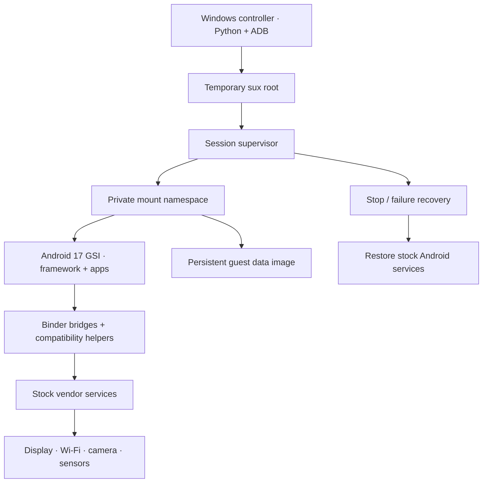

<div align="center">

# OpenOOS

### Open Origin OS

**One phone. A different Android userspace.**

[](#what-is-this)
[](#compatibility)
[](#feature-status)
[](#how-it-works)
[](#getting-started)
[](https://github.com/xAmarnath/OpenOOS/actions/workflows/source-check.yml)

Run an Android 17 GSI userspace on an iQOO 13 using temporary root,
the stock kernel, and bridges to the phone's vendor services.

[How it works](#how-it-works) · [Feature status](#feature-status) · [Getting started](#getting-started) · [Development](docs/DEVELOPMENT.md)

</div>

---

## What is this?

OpenOOS is an experimental Android guest runtime for the **iQOO 13 / I2401**.
It switches the phone's active Android framework and display to a GSI while
reusing the running stock kernel and selected hardware services.

The name expands to **Open Origin OS**. This project is a community experiment;
it does not contain OriginOS source code and is not affiliated with vivo or iQOO.
The approach was inspired by [OneLineage](https://github.com/WeWaffles/OneLineage).

### The idea in four lines

- **Temporary root starts the session.** The controller uses the existing `sux` setup.
- **A private filesystem view holds the guest.** GSI and APEX images are mounted read-only; guest data uses its own image file.
- **Hardware comes through the host.** Binder bridges connect selected guest services to the stock vendor stack.
- **Guest data survives.** A reboot returns to stock and clears this temporary-root session; guest files remain until removed.

## How it works



At handover, the runtime stops selected stock services, including stock Zygote
and SurfaceFlinger, and starts the guest framework. A supervisor tracks the
guest process group and restores the captured stock service and SELinux policy
state when the session ends. Sessions have **no fixed time limit**; manual stop
and failure recovery remain enabled.

The guest shares the stock kernel and some hardware state. This is not a virtual
machine security boundary. The design avoids flashing stock system, vendor,
boot, or modem partitions, but a userspace failure can still freeze the device
or require a reboot. Runtime policy, services, network state, and brightness can
change during a session. See [storage and recovery](docs/OPERATIONS.md).

## Feature status

These are observations from development sessions, **not a guarantee for the
latest build**. The latest unlock-key encoding fix still needs owner validation.

| Feature | Observed status |
| :--- | :--- |
| Home screen, Settings, About phone | Reached in earlier guest sessions |
| Display | Owner confirmed visible without blinking after the inherited file-descriptor fix |
| Gestures, density, transitions | Configured and exercised in earlier sessions; ongoing user validation |
| Wi-Fi | Connected and Android validated internet access in an earlier session |
| Modem | Baseband and two SIM slots detected; calls, SMS, and mobile data untested without a SIM |
| Camera | OpenCamera preview worked; stock vivo Camera has unresolved framework dependencies |
| Sensors | 54 enumerated; live events observed from several standard sensors |
| Brightness | Slider controlled the physical backlight in an earlier session |
| Bluetooth / NFC / GNSS | Partial bring-up; pairing, NFC transactions, and a location fix remain unverified |
| Monster Halo | Guest control app and stock VLight HAL integration; physical effects need confirmation |
| Storage | Persistent image; controller targets 32 GiB. Saving and downloads need retesting after storage fixes |
| Screen lock / KeyMint | Guest key bridge and isolated credential service implemented; end-to-end validation pending |
| Google sign-in | **Unresolved**. Google services launching is not a successful account login |
| Hardware attestation | **Unresolved**. A hardware backend does not establish successful app attestation or Play Integrity |
| Audio | Not tested |

## Compatibility

| Component | Development target |
| :--- | :--- |
| Phone | iQOO 13, model `I2401`, ARM64 |
| Stock firmware | Exact fingerprint recorded in [`guest-device.json`](guest-device.json) |
| Guest | Android 17 GSI and matching extracted APEX payloads |
| Root | Already working temporary `sux` at `/apex/com.android.virt/bin/sux` |
| Controller | Windows, Python 3.10+, Android Platform Tools |

Native helpers, service names, policies, and binary patch offsets are tied to
this firmware. The controller rejects a different stock fingerprint. Other
phones and firmware versions need porting work.

## Getting started

**This repository is a source snapshot, not a complete flashable ROM or a
download-and-run installer.** The GSI, data images, APKs, proprietary libraries,
and compiled runtime are not included. An external image download has not been
published yet. [`docs/runtime-inventory.json`](docs/runtime-inventory.json)
records the runtime files used during development, with sizes and SHA-256 hashes.

```powershell
git clone https://github.com/xAmarnath/OpenOOS.git
cd OpenOOS
python tools/verify-source.py
```

That check stays on the PC. For building and preparing dependencies, start with
[Development](docs/DEVELOPMENT.md). For an already prepared, compatible runtime,
the controller supports:

```powershell
$env:OPENOOS_SERIAL = 'YOUR_ADB_DEVICE_ID'
python gsi.py setup
python gsi.py start
python gsi.py status
python gsi.py stop
python gsi.py close
```

`setup` needs all runtime files and the prepared guest directory; cloning this
repository alone is insufficient. Read [Operations](docs/OPERATIONS.md) before
using the device commands, reset, or removal.

## Inside the repo

| Path | Purpose |
| :--- | :--- |
| `gsi.py`, `device.py` | Session controls, device checks, ADB transport |
| `guest_bundle.py` | Local private bundle export, verification, and installation |
| `namespace-v3.sh`, `system-preflight-v3.sh` | Filesystem isolation and framework startup |
| `guest-supervisor.c`, `recover-v3.sh` | Process supervision and stock recovery |
| `guest-*.c`, `guest-fd-hygiene.h` | Guest launch, properties, storage, and descriptor handling |
| `network-port/` | Hardware/network Binder bridges and UID network handling |
| `keymint-port/` | Guest-owned key tracking and guest credential service |
| `hardware-port/` | Sensors, brightness, camera helpers, and Monster Halo app source |
| `docs/` | Runtime inventory, limitations, build notes, and lifecycle commands |
| `tools/` | Source package verification |

## Next milestones

- [x] Display a usable GSI home screen and Settings on the physical phone
- [x] Bridge initial hardware services and persist guest data
- [x] Separate source from device images and private session data
- [ ] Validate unlock, shared storage, downloads, and Google sign-in after the latest fixes
- [ ] Verify app hardware attestation and remaining hardware features
- [ ] Make the full dependency/build process reproducible from a clean checkout
- [ ] Publish a clean image separately, with checksums and matching version information

## Credits and contributions

[OneLineage](https://github.com/WeWaffles/OneLineage) sparked the experiment.
The runtime also relies on Android/AOSP, the stock vivo/Qualcomm stack,
[libgbinder](https://github.com/mer-hybris/libgbinder),
[libglibutil](https://github.com/sailfishos/libglibutil), Zig, BusyBox, and Magisk tools.
Dependencies retain their upstream licenses; their binaries are not bundled here.
A project-wide source license has not yet been selected.

Useful issue reports include the firmware fingerprint, guest version, exact
action, and redacted logs. Remove device identifiers, accounts, Wi-Fi credentials,
and key material before posting. See [distribution notes](docs/DISTRIBUTION.md).
