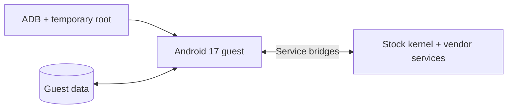

<div align="center">

# OpenOOS

### Open Origin OS

**A new Android userspace. The hardware you already have.**

[](#what-is-this)
[](#compatibility)
[](#feature-status)
[](#how-it-works)
[](#getting-started)
[](https://github.com/xAmarnath/OpenOOS/actions/workflows/source-check.yml)

Run an Android 17 GSI userspace on an iQOO 13 using temporary root,
the stock kernel, and bridges to the phone's vendor services.

[How it works](#how-it-works) · [Feature status](#feature-status) · [Getting started](#getting-started) · [Development](docs/DEVELOPMENT.md)

</div>

---

## What is this?

OpenOOS is an experimental Android guest runtime for the **iQOO 13 / I2401**.
It switches the phone's active Android framework and display to a GSI while
reusing the running stock kernel and selected hardware services.

The name expands to **Open Origin OS**. This project is a community experiment;
it does not contain OriginOS source code and is not affiliated with vivo or iQOO.

### At a glance

- **Temporary root starts the session.** The controller uses the existing `sux` setup.
- **A private filesystem view holds the guest.** GSI and APEX images are mounted read-only; guest data uses its own image file.
- **Hardware comes through the host.** Binder bridges connect selected guest services to the stock vendor stack.
- **Guest data survives.** A reboot returns to stock and clears this temporary-root session; guest files remain until removed.

## How it works



At handover, the runtime stops selected stock services, including stock Zygote
and SurfaceFlinger, and starts the guest framework. A supervisor tracks the
guest process group and restores the captured stock service and SELinux policy
state when the session ends. Sessions have **no fixed time limit**; manual stop
and failure recovery remain enabled.

The guest shares the stock kernel and some hardware state. This is not a virtual
machine security boundary. The design avoids flashing stock system, vendor,
boot, or modem partitions, but a userspace failure can still freeze the device
or require a reboot. Runtime policy, services, network state, and brightness can
change during a session. See [storage and recovery](docs/OPERATIONS.md).

## Feature status

**✅ Verified for the behavior listed · ❌ Known failure without a confirmed fix · ⬜ Unverified**

Results are scoped to development tests on the target device. A check mark does
not imply that every use case or the latest build has passed a full regression test.

| Feature | Status | Tested behavior / remaining work |
| :--- | :---: | :--- |
| Display output | ✅ | Visible without blinking after the frame-fence fix |
| Display configuration | ✅ | 1440 × 3168 at 600 dpi; portrait status bar clears the rounded corners |
| Touch & gesture input | ✅ | Touch, gesture navigation, and smooth transitions work |
| Wi-Fi & internet | ✅ | Connected network with Android-validated internet access |
| Modem detection | ✅ | Baseband and two SIM slots detected |
| Calls, SMS & mobile data | ⬜ | Active-SIM testing pending |
| Camera preview | ✅ | OpenCamera preview works |
| Stock vivo Camera | ❌ | Proprietary framework dependencies remain unresolved |
| Sensors | ✅ | 54 enumerated; live events from several standard sensors |
| Brightness slider | ✅ | Controls the physical backlight |
| Bluetooth | ⬜ | Pairing and data transfer need verification |
| NFC | ⬜ | Transactions need verification |
| GNSS | ⬜ | A location fix needs verification |
| Persistent storage | ✅ | Separate writable 32 GiB guest data image |
| Shared storage | ✅ | Downloads and media saving work |
| Credential backend | ❌ | Screen-lock setup failed; latest key-bridge fixes await retesting |
| Hardware-backed keys & attestation | ✅ | Hardware-backed key generation and app attestation work |
| Audio | ⬜ | Untested |

| Operating mode | Status | Behavior / remaining work |
| :--- | :---: | :--- |
| Guest session | ✅ | Android 17 userspace runs on the stock kernel with no fixed session time limit |
| Return to stock | ✅ | Existing controller stops the guest and restores stock services |
| Persistent guest data | ✅ | Guest app data is retained between sessions |
| Reboot to stock | ✅ | Reboot restores the stock boot path; temporary root must be set up again |
| On-device switching | ⬜ | Switcher app and phone-side controller are in development |

Google services launch, but Google account sign-in currently does not complete.

## Compatibility

| Component | Development target |
| :--- | :--- |
| Phone | iQOO 13, model `I2401`, ARM64 |
| Stock firmware | Exact fingerprint recorded in [`guest-device.json`](guest-device.json) |
| Guest | Android 17 GSI and matching extracted APEX payloads |
| Root | Already working temporary `sux` at `/apex/com.android.virt/bin/sux` |
| Controller | Windows, Python 3.10+, Android Platform Tools |

Native helpers, service names, policies, and binary patch offsets are tied to
this firmware. The controller rejects a different stock fingerprint. Other
phones and firmware versions need porting work.

## Getting started

**This repository is a source snapshot, not a complete flashable ROM or a
download-and-run installer.** The GSI, data images, APKs, proprietary libraries,
and compiled runtime are not included. An external image download has not been
published yet. [`docs/runtime-inventory.json`](docs/runtime-inventory.json)
records the runtime files used during development, with sizes and SHA-256 hashes.

```powershell
git clone https://github.com/xAmarnath/OpenOOS.git
cd OpenOOS
python tools/verify-source.py
```

That check stays on the PC. For building and preparing dependencies, start with
[Development](docs/DEVELOPMENT.md). For an already prepared, compatible runtime,
the controller supports:

```powershell
$env:OPENOOS_SERIAL = 'YOUR_ADB_DEVICE_ID'
python gsi.py setup
python gsi.py start
python gsi.py status
python gsi.py stop
python gsi.py close
```

`setup` needs all runtime files and the prepared guest directory; cloning this
repository alone is insufficient. Read [Operations](docs/OPERATIONS.md) before
using the device commands, reset, or removal.

## Inside the repo

| Path | Purpose |
| :--- | :--- |
| `gsi.py`, `device.py` | Session controls, device checks, ADB transport |
| `guest_bundle.py` | Local private bundle export, verification, and installation |
| `namespace-v3.sh`, `system-preflight-v3.sh` | Filesystem isolation and framework startup |
| `guest-supervisor.c`, `recover-v3.sh` | Process supervision and stock recovery |
| `guest-*.c`, `guest-fd-hygiene.h` | Guest launch, properties, storage, and descriptor handling |
| `network-port/` | Hardware/network Binder bridges and UID network handling |
| `keymint-port/` | Guest-owned key tracking and guest credential service |
| `hardware-port/` | Sensors, brightness, and camera helpers |
| `docs/` | Runtime inventory, limitations, build notes, and lifecycle commands |
| `tools/` | Source package verification |

## Next milestones

- [x] Drive the physical display from the guest Android framework
- [x] Bridge initial hardware services and persist guest data
- [x] Separate source from device images and private session data
- [x] Validate shared storage, downloads, and app hardware attestation
- [ ] Validate screen lock, Google sign-in, and remaining hardware features
- [ ] Make the full dependency/build process reproducible from a clean checkout
- [ ] Publish a clean image separately, with checksums and matching version information

## Credits and contributions

The runtime relies on Android/AOSP, the stock vivo/Qualcomm stack,
[libgbinder](https://github.com/mer-hybris/libgbinder),
[libglibutil](https://github.com/sailfishos/libglibutil), Zig, BusyBox, and Magisk tools.
Dependencies retain their upstream licenses; their binaries are not bundled here.
A project-wide source license has not yet been selected.

Useful issue reports include the firmware fingerprint, guest version, exact
action, and redacted logs. Remove device identifiers, accounts, Wi-Fi credentials,
and key material before posting. See [distribution notes](docs/DISTRIBUTION.md).
